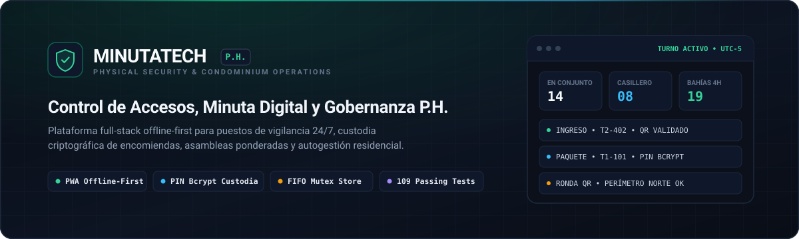
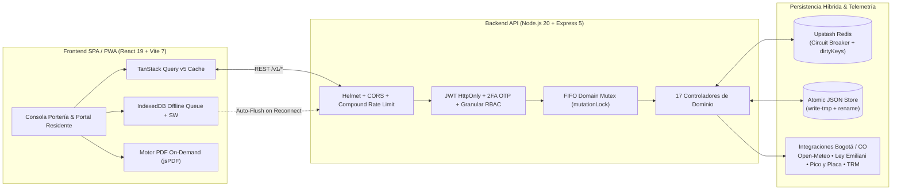

<div align="center">



<br />

[](https://github.com/Sebas0317/proyecto-minuta/actions/workflows/ci.yml)
[](LICENSE)
[](backend/tests)
[](frontend/src/test)
[](frontend/public/sw.js)
[](backend/package.json)
[](frontend/package.json)

**Plataforma open-source de seguridad física, operación de portería 24/7 y administración de propiedad horizontal.**  
Diseñada para conjuntos residenciales y edificios corporativos en Latinoamérica bajo los lineamientos de la **Ley 675 de 2001** y la **Ley 1755 de 2015**.

[Arquitectura](#-arquitectura-del-sistema) • [Ingeniería Destacada](#-decisiones-de-ingeniería) • [Módulos por Rol](#-módulos-por-rol) • [Inicio Rápido](#-inicio-rápido-local) • [Seguridad y Pruebas](#-seguridad-y-calidad) • [Contribuir](CONTRIBUTING.md)

</div>

---

<details>
<summary><strong>🌐 English Overview (Click to expand)</strong></summary>

<br />

**MinutaTech P.H.** is a full-stack **Physical Security, Guardhouse Operations & Condominium Governance Platform** built with **Node.js 20 + Express 5** and **React 19 + Vite 7 + TanStack Query**.

Unlike generic CRUD property dashboards, MinutaTech solves real-world guardhouse reliability and security challenges:
- **Offline-First Guardhouse Continuity:** Service Worker + transactional `IndexedDB` mutation queue (`offlineQueue.js`) lets security guards log visitor entries, shift logs, parking allocations, and QR patrol checkpoints during internet outages, automatically syncing once connectivity returns.
- **Cryptographic Package Custody:** One-time 4-digit delivery PINs hashed at rest with `bcrypt`, paired with compound `IP + resourceId` rate-limiting to prevent brute-force parcel claims.
- **Zero-Race-Condition Hybrid Persistence:** Per-domain FIFO mutex locks (`mutationLock.js`) protect atomic `tmp + rename` local JSON writes alongside an **Upstash Redis** layer with automatic circuit-breaker failover and `dirtyKeys` resynchronization.
- **Legal Governance Out of the Box:** Weighted condominium assembly voting by unit ownership coefficient (`0.01% – 5.00%`), business-day SLA calculation (`Ley Emiliani` Colombian holidays in `UTC-5`), and client-side verified PDF clearance certificates (`Paz y Salvo`).

</details>

---

## 🎯 El Problema que Resuelve

En miles de copropiedades residenciales, la operación diaria de seguridad y administración sigue fragmentada entre libros de minuta en papel, grupos informales de mensajería y hojas de cálculo sin trazabilidad:

1. **Pérdida de trazabilidad en garita:** Cuando cae el internet del puesto de vigilancia, las plataformas nube tradicionales dejan a los guardas a ciegas.
2. **Disputas en custodia de paquetería:** Entregas de comercio electrónico sin validación criptográfica de quién retiró el paquete ni registro horario auditable.
3. **Fricción entre portería, administración y residentes:** Certificados de Paz y Salvo manuales, sobrecupo en parqueaderos de visitantes, votaciones de asamblea sin ponderación real por coeficiente y PQRS sin control de vencimientos legales.

**MinutaTech P.H.** unifica la consola táctica del guarda de seguridad, el backoffice administrativo y el portal de autogestión del residente en un único monorepo ligero, rápido de desplegar y auditable de extremo a extremo.

---

## 🏗 Arquitectura del Sistema



---

## ⚡ Decisiones de Ingeniería

| Desafío Operativo | Implementación en MinutaTech P.H. | Ubicación Clave |
| :--- | :--- | :--- |
| **Cortes de internet en portería** | Cola persistente en `IndexedDB` que intercepta fallos de red en mutaciones críticas (minuta, ingresos, parqueaderos, rondas) y ejecuta `flushOfflineQueue` con bloqueo de concurrencia al reconectar. | `frontend/src/services/offlineQueue.js` `frontend/public/sw.js` |
| **Suplantación en retiro de paquetes** | Generación de PIN único de 4 dígitos con hash `bcrypt` en reposo; el texto plano solo se retorna una vez en el alta y nunca se expone en listados posteriores. | `backend/src/controllers/paqueteriaController.js` |
| **Condiciones de carrera bajo carga** | Serialización por dominio mediante promesas encadenadas FIFO (`mutationLock`) con liberación garantizada ante desconexiones tempranas (`res.destroyed`). | `backend/src/middleware/mutationLock.js` |
| **Resiliencia ante caída de Redis** | Patrón *Circuit Breaker* sobre Upstash Redis con fallback transparente a escritura atómica local (`tmp + rename`) y reconciliación automática de `dirtyKeys` al restaurarse el servicio. | `backend/src/services/jsonStore.js` |
| **Control de acceso de mínimo privilegio** | Sesiones `HttpOnly` + `SameSite`, verificación 2FA real, tokens de recuperación de un solo uso vinculados al hash de contraseña (`pwdFp`) y matriz RBAC granular por rol (`owner`, `admin`, `guarda`). | `backend/src/middleware/rbac.js` `backend/src/controllers/authController.js` |
| **Normativa colombiana en `UTC-5`** | Cálculo determinístico de los 18 festivos oficiales de Colombia (*Ley Emiliani*), plazos de 15 días hábiles para PQRS (*Ley 1755*), quórum ponderado por coeficiente (*Ley 675*) y Pico y Placa Bogotá. | `backend/src/services/integracionesService.js` |

---

## 🧩 Módulos por Rol

| Consola de Portería (`guarda`) | Administración (`admin` / `owner`) | Portal de Residentes (`residente`) |
| :--- | :--- | :--- |
| • **Tablero Operativo en Vivo:** Ingresos, salidas, permanencia y buscador predictivo por apto, cédula o placa. | • **Censo Maestro y Mapa Interactivo:** Estado habitacional, contratos de arriendo, vehículos y cartera por torre/unidad. | • **Estado de Cuenta y Certificados:** Descarga inmediata de Paz y Salvo oficial en PDF (bloqueado automáticamente en mora). |
| • **Casillero con PIN y WhatsApp:** Recepción de encomiendas y recibos públicos con alerta de facturas `>30 días`. | • **Asambleas y Votaciones (Ley 675):** Control de quórum en vivo y escrutinio ponderado por coeficiente de copropiedad. | • **Pases QR de Visitantes:** Pre-autorización anticipada de visitas, domiciliarios y contratistas. |
| • **Minuta Digital y Rondas QR:** Libro cronológico auditable, relevos de turno, puntos de control perimetral y botón SOS. | • **Gestión PQRS y Equipos:** Radicados con semáforo de días hábiles, inspección de extintores/activos, usuarios y logs de seguridad. | • **Autogestión Residencial:** Consulta de paquetes, reserva de zonas comunes sin solapamientos, radicación PQRS, mascotas y asistente **MinutaBot**. |

---

## 🚀 Inicio Rápido Local

### Prerrequisitos
- **Node.js** `>= 20.0.0` y **npm** `>= 10`
- *(Opcional)* Cuenta en **Upstash Redis** para persistencia distribuida en despliegues serverless; en local funciona de inmediato con almacenamiento atómico en disco.

### 1. Clonar e instalar dependencias

```bash
git clone https://github.com/Sebas0317/proyecto-minuta.git
cd proyecto-minuta

cd backend && npm ci
cd ../frontend && npm ci
```

### 2. Configurar variables de entorno

Crea `backend/.env` a partir de la plantilla incluida en `backend/.env.example`:

```env
PORT=3001
NODE_ENV=development
JWT_SECRET=reemplazar_por_secreto_aleatorio_de_minimo_32_caracteres
CORS_ORIGIN=http://localhost:5173
```

### 3. Iniciar servidores de desarrollo

En dos terminales independientes:

```bash
# Terminal 1 — API REST (http://localhost:3001)
cd backend
npm run dev
```

```bash
# Terminal 2 — Aplicación Web PWA (http://localhost:5173)
cd frontend
npm run dev
```

---

## 🛡 Seguridad y Calidad

El repositorio mantiene verificación continua mediante GitHub Actions (`.github/workflows/ci.yml`) con acciones fijadas por hash SHA y permisos mínimos:

```bash
# Suite de integración, concurrencia, RBAC y seguridad del Backend (80 tests)
cd backend && npm test

# Linter estricto sin advertencias + Pruebas de flujos UI + Build de producción (29 tests)
cd frontend && npx eslint . --max-warnings=0 && npm test && npm run build
```

### Controles de Seguridad Implementados
- **Protección Anti-Fuerza Bruta Compuesta:** Rate-limiting independiente por combinación `IP + identificador/recurso` en login, verificación 2FA, recuperación de cuenta y validación de PINs.
- **Exportaciones Seguras:** Sanitización contra *CSV Formula Injection* (`=`, `+`, `-`, `@`) y descargas mediante `Blob` autenticado sin exponer credenciales en URLs.
- **Auditoría Estática y de Reglas:** Código auditado al 100% sobre 81 archivos fuente con remediación completa de hallazgos críticos, altos y medios. Reporte de vulnerabilidades disponible en [SECURITY.md](SECURITY.md).

---

## 📂 Estructura del Monorepo

```text
proyecto-minuta/
├── .github/
│   ├── assets/banner.svg          # Identidad gráfica vectorial del repositorio
│   ├── ISSUE_TEMPLATE/            # Plantillas estructuradas para bugs y mejoras
│   ├── PULL_REQUEST_TEMPLATE.md   # Checklist de revisión para colaboradores
│   └── workflows/ci.yml           # Pipeline CI endurecido (Backend + Frontend + Build)
├── backend/
│   ├── src/
│   │   ├── config/                # Constantes, logger estructurado y entorno
│   │   ├── controllers/           # Lógica de negocio (accesos, minuta, paquetes, PQRS, asambleas...)
│   │   ├── middleware/            # Auth JWT, RBAC granular, rateLimiter, FIFO mutationLock
│   │   ├── routes/                # Endpoints REST versionados (/v1/*)
│   │   └── services/              # Persistencia híbrida Redis/JSON e integraciones Colombia
│   └── tests/                     # 80 pruebas de integración, estrés y seguridad
├── frontend/
│   ├── public/                    # Service Worker (sw.js), Web App Manifest e íconos PWA
│   └── src/
│       ├── components/            # Consolas operativas, Portal Residente y modales lazy-loaded
│       ├── hooks/                 # Hooks de caché reactiva (@tanstack/react-query) y sesión
│       ├── services/              # Cliente HTTP centralizado y cola offline IndexedDB
│       ├── test/                  # 29 pruebas unitarias y de flujos de usuario (Vitest + RTL)
│       └── utils/                 # Generador dinámico de certificados y actas en PDF
├── CONTRIBUTING.md
├── LICENSE
└── SECURITY.md
```

---

## 🗺 Roadmap Abierto

¿Quieres aportar al proyecto? Estas son las próximas líneas de evolución abiertas a la comunidad:

- [ ] Notificaciones *Web Push* nativas (VAPID) al registrar correspondencia en portería.
- [ ] Lectura óptica desde cámara móvil para escaneo directo de cédulas colombianas (PDF417) y códigos QR de visitantes.
- [ ] Adaptador opcional PostgreSQL / Supabase manteniendo la interfaz de repositorio actual.
- [ ] Modo multi-copropiedad (*multi-tenant*) para empresas de vigilancia y firmas administradoras.

Revisa la guía en [CONTRIBUTING.md](CONTRIBUTING.md) para levantar tu entorno y enviar un Pull Request.

---

## ⭐ Apoya el Proyecto

Si este repositorio te resulta útil como referencia de arquitectura **PropTech**, **PWA Offline-First** o **Seguridad Física en Node.js + React**, considera darle una **estrella (⭐)** en GitHub y compartirlo con otros desarrolladores.

## 📄 Licencia

Distribuido bajo la licencia **MIT**. Consulta el archivo [LICENSE](LICENSE) para más detalles.
